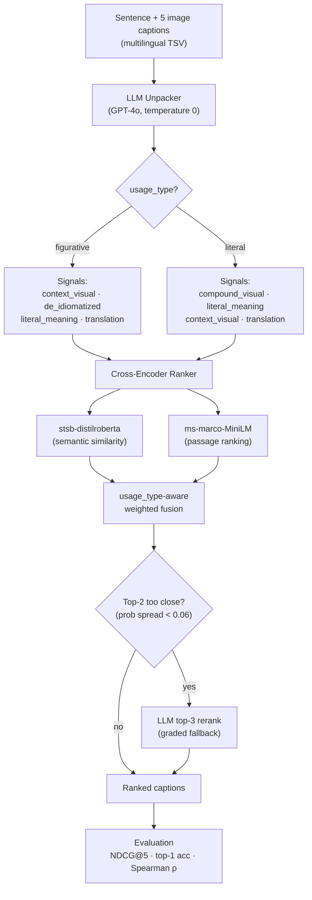

# AdMIRe 2.0 — Text-Only Idiom-Aware Image Ranking

Rank candidate images for an idiom-bearing sentence **without a vision model** — by unpacking what the sentence *actually means* (literal vs. figurative) with an LLM and matching that meaning against each image's caption.

The task (AdMIRe 2.0): given a sentence in some language that contains a potentially idiomatic compound, order its **5 candidate images** by how well they fit the *intended* sense of the sentence. Most approaches reach for a vision encoder; this one deliberately does not — it treats the image captions as text and moves the whole problem into language space, where an idiom can be disambiguated explicitly before ranking.

## Architecture



The LLM never sees the images — only the sentence. It emits a small JSON object (usage type, English translation, literal meaning, and two visual descriptions: the real-world scene vs. a literal picture of the idiom). The ranker scores each caption against those fields with **two complementary cross-encoders**, then fuses their scores with weights that depend on whether the compound is used figuratively or literally.

### Signal weighting

The core idea is that a *figurative* sentence should be matched by the scene it describes, while a *literal* one should be matched by a picture of the compound itself. The fusion weights encode exactly that split:

| signal | figurative | literal |
|---|---|---|
| `context_visual` | 0.55 | 0.20 |
| `compound_visual` | 0.00 | 0.45 |
| `literal_meaning` | 0.15 | 0.25 |
| `english_translation` | 0.05 | 0.10 |
| `de_idiomatized_sentence` | 0.25 | — |
| stsb cross-encoder | 0.80 | 0.30 |
| ms-marco cross-encoder | 0.20 | 0.70 |

When the top two candidates are within a narrow probability spread, a **graded fallback** re-scores that row: it escalates low-confidence cases to an LLM top-3 rerank rather than committing to a coin-flip ordering.

## Models

| Role | Model |
|---|---|
| LLM unpacker / reranker | `gpt-4o` (configurable; `gpt-4o-mini` supported) |
| Cross-encoder — semantic similarity | `cross-encoder/stsb-distilroberta-base` |
| Cross-encoder — passage ranking | `cross-encoder/ms-marco-MiniLM-L-6-v2` |

Cross-encoders run on Apple Silicon (`mps`) when available, otherwise CPU.

## Evaluation

`src/evaluate.py` reports, per language and overall:

- **NDCG@5** with graded relevance `3/1/0/0/0` — the primary metric, rewarding a correct top rank most and giving partial credit for a near-miss.
- **Top-1 accuracy** — how often the intended image is ranked first.
- **Average Spearman ρ** — rank correlation against the gold ordering across all 5 positions.

Because the LLM is non-deterministic even at `temperature=0`, scores can move by a few points between runs.

## Setup

```bash
git clone https://github.com/muhammedabdullahozdemirr/admire-2.0-multilingual-idiom-aware-image-ranking.git
cd admire-2.0-multilingual-idiom-aware-image-ranking
python3 -m venv venv
source venv/bin/activate
pip install -r requirements.txt
```

Create a `.env` file in the project root:

```
OPENAI_API_KEY=sk-...
# optional overrides
LLM_MODEL=gpt-4o
LLM_TOP3_RERANK_ENABLED=true
```

## Usage

```bash
# Run all language files end-to-end, producing Codabench-ready submissions
python main.py

# Run a single language
python main.py --lang Turkish
python main.py --lang Chinese

# Quick benchmark: 20 Chinese rows + 30 Turkish rows against bundled ground truth
python main.py --mini-benchmarks
```

Outputs land in `outputs/` (`predictions_<Lang>.tsv` and Codabench-ready `submission_*.tsv`).

## Project layout

```
.
├── main.py                         # CLI entry point / orchestration
├── rebuild_submissions_from_predictions.py
├── requirements.txt
├── benchmarks/                     # bundled ground truth (20 zh + 30 tr)
├── data/                           # submission_*.tsv inputs
├── outputs/                        # predictions + submissions (gitignored)
├── scripts/
│   └── report_confidence_slice.py  # confidence-sliced error analysis
└── src/
    ├── config.py                   # env-driven config & device detection
    ├── data_loader.py              # multilingual TSV loader
    ├── llm_unpacker.py             # sentence → structured JSON meaning
    ├── llm_rerank_prompts.py       # top-3 rerank prompting
    ├── ranker.py                   # cross-encoder scoring + fusion
    ├── pipeline.py                 # per-row end-to-end pipeline
    └── evaluate.py                 # NDCG@5 / accuracy / Spearman
```

## Notes

- The LLM is non-deterministic even at `temperature=0`; expect small run-to-run variation.
- Request rate limiting is controlled by `LLM_MIN_REQUEST_INTERVAL_SEC` in `config.py`.
